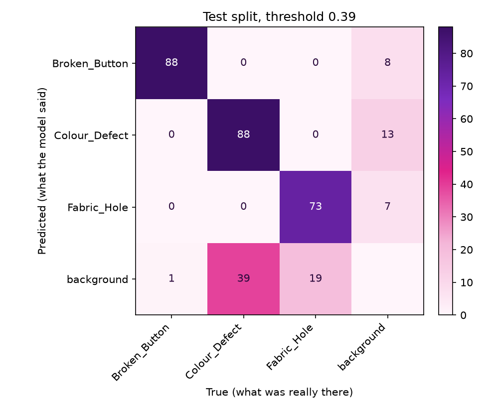
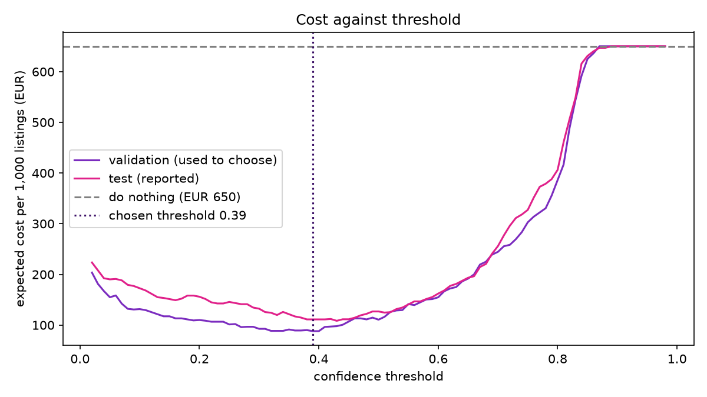
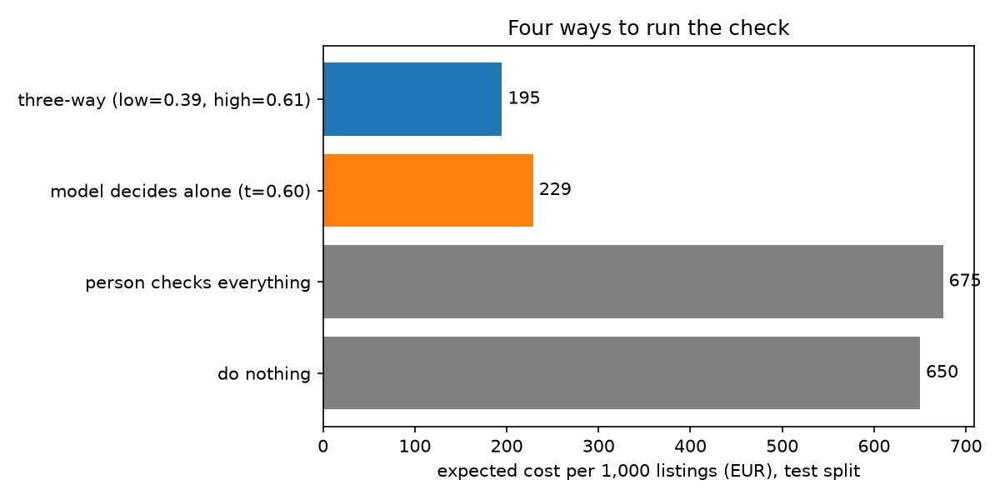

# Assignment 2 Report

- **Name**: Tessa Correig Martra
- **Student ID**:19614
- **Email**:tcorreig.ieu2022@student.ie.edu
- **Group**: BBADBA 5A

## Business problem and the cost of being wrong
**Business problem:** On a second-hand marketplace like Vinted or Wallapop, sellers take their own photos with a phone and describe the item themselves. The platform promises buyers a refund when an item arrives damaged or is significantly not as described. So when a seller forgets or chooses not to mention, a hole, a stain or a broken button, the buyer finds out only after paying and waiting for the parcel. Then the platform has to handle a dispute between the buyer and the seller with only one person's word against the other's. This costs the platform return shipping, support time and the risk that the buyer does not come back, which it is slow and frustrating for everybody. 

The model I built helps at the cheapest moment, which is before the listing goes live. It looks at the seller's photos and checks whether they show a defect. If the model is sure there is a defect, the seller is asked to declare it, so an honest seller can still sell the item and the buyer knows what they are buying. Also the model can be sure that there isn't a defect and then nothing happens.  If the model is unsure, a human takes a look and decides.  Each listing ends in one of three outcomes:

- **Pass:** the listing goes live.
- **Human review:** a person looks at the photos to decide if there is a defect.
- **Fail:** the seller is automatically asked to declare the defect before putting it out for sale, with no human intervention needed.

**Who acts on it:** The platform's moderation team handles the review cases and the seller acts on an automatic fail.

**How the model's output becomes a decision:** The model draws boxes with a confidence score. A listing's score is the confidence of its most confident box and two thresholds split the scores into pass, review and fail. One test image stands for one listing. Real listings have several photos, so a real system would use the highest score across them. The model does not read the listing text, so it also flags defects the seller has already declared. I do not price that cost.

**The positive class:** For the costing, positive means that a defect of any type is present in the listing. I chose this because the buyer does not care whether the problem is a hole or a stain, so the platform's decision is a single yes or no. Per-class precision and recall are still reported separately in the evaluation.

**What each mistake costs:** Every figure below is an assumption. The sensitivity analysis later shows what happens if each one is wrong.

- **A missed defect (false negative) costs about 13 euros:** The buyer receives an item that does not match its description. I split this into three parts:
  - Return shipping: 4 euros. Moreless like Vinted.
  - Support time to handle the dispute: 4 euros. About 15 minutes of an agent at approximately 16 euros per hour.
  - Goodwill: 5 euros, I assumed that 25% of buyers who receive a defective item stop buying and that each would have placed about 10 more orders. Vinted's fee is roughly 5% of the item price plus 0.7 euros, which is about 1.5 euros on a 15 to 20 euros item. That gives about 3.75 euros and I rounded up to 5 euros to allow for bad word of mouth.

  I did not include the item price because in these platforms usually the buyer's payment is held until they confirm the item matches its description, so a refund comes out of that held payment. If the platform paid the item price, a missed defect would cost about 15 to 20 euros more, which is close to the 30 euros case in my sensitivity table.

- **A false alarm sent to review costs 0.50 euros:** A moderator spends about 1.5 minutes on the listing, at approximately 20 euros per hour.
- **A good listing that is failed automatically costs 3 euros:** Neither the model nor the moderator catch the mistake, the seller loses time and may contact support. I made this six times the cost of a false alarm.
- **A moderator reaches the right verdict 95% of the time** in both directions. I could not measure this, so it is an assumption.
- **A correct decision costs nothing extra.**

**Why one mistake is worse:** A missed defect costs about 26 times more than a false alarm (13 euros against 0.50 euros). It also happens after the sale, when a customer has already received a damaged item. A false alarm only costs a moderator about a minute and a half to look at the photos. So it is much cheaper for the model to flag too many listings than to let a defect through. This is why I chose the thresholds the way I did, why some listings go to a person and why I use a review zone instead of a single cut-off.

**Why accuracy is the wrong metric:** If 5% of listings are defective, a model that never flags anything is right 95% of the time, yet it lets every defect through and costs 650 euros per 1,000 listings. I therefore judge the model by cost and I report recall and precision per class.

**The base rate:** I assumed that 5% of listings have an undeclared defect. I chose 5% because it is high enough to matter and low enough to reflect that most sellers describe their items honestly. I test 2% and 10% later.

## Dataset
**Dataset used:** Roboflow Universe, workspace `defect-5hwax`, project `fabric-defect-ieswu`, **version 16**.

Link: https://universe.roboflow.com/defect-5hwax/fabric-defect-ieswu

**What one image is:** A 512x512 photo of fabric or clothing, with a box drawn around each defect. In this project one image stands for one listing.

**The classes:**
- `Broken_Button`: a button that is broken or damaged.
- `Colour_Defect`: a stain or a discoloured patch. 
- `Fabric_Hole`: a hole or tear in the fabric.

There is no "good garment" class. A listing is passed when the model finds no defect.

**Black and white images:** The dataset's author converted all the photos to black and white (and also made them all the same size, 512x512, and adjusted their contrast).

**What happens when a user uploads a colour photo:** The model has only ever seen black and white photos, so a colour photo would be something new for it. To solve this, the dashboard first changes a colour photo to black and white, makes it the same size and adjusts its contrast, so it looks like the photos the model was trained on. Photos that are already black and white are left as they are. 

**Why this dataset works:** I chose this dataset because its three classes are the defects the marketplace cares about, because every defect has a box (so I can check that the model flags the right place and not only the right photo), and because the majority of the file names on the Universe page are photos taken with a phone, which is exactly how the phots will be taken for the purpose of the model.

## What the dataset's composition implies
**The numbers:** I counted these from the label files that `train.py` downloads. One photo can contain more than one defect (the test set has 308 defects in 214 photos).

| Split | Photos | Broken_Button | Colour_Defect | Fabric_Hole |
|---|---|---|---|---|
| Train | 3,630 | 1,389 | 1,855 | 2,090 |
| Validation | 234 | 99 | 132 | 103 |
| Test | 214 | 89 | 127 | 92 |

**The training set is smaller than it looks:** Each training photo was copied 3 times with small changes such as flips and rotations, so the 3,630 training photos come from about 1,210 originals. That makes about 1,660 real photos in total, and the real split is about 73% train, 14% validation and 13% test. The training counts per class are inflated about 3 times in the same way. The validation and test photos are not copied, so those counts are real.

**Which numbers are too thin to trust:** In the test set, each defect type has only about 90 to 130 examples. With so few, the results can move a lot just by luck. For example, a recall of 80% could really be anywhere between about 73% and 87% (this is my own rough estimate, I did not measure it). So I ignore small differences between classes, and I only trust big ones. The validation set is small too (234 photos), and I used it to choose the thresholds. That is why I then checked the choice on the test set, and why I do not treat the exact threshold as perfect.

**The defects are small:** In the test set, a typical button covers 2.4% of the photo, a colour defect 1.0% and a hole 0.7%. A hole is about the size of a 40 by 40 pixel square in a 512 by 512 photo. Small objects are harder for a model to find, so I did not shrink the photos for training, and I expect the small classes (holes and colour defects) to be harder than buttons.

**There are almost no photos of good garments:** All 214 test photos and all 234 validation photos contain at least one defect, and only 4 of the 3,630 training photos have none. This is normal for a dataset that was made to find defects, and I planned for it in four ways:
- **False alarms:** I cannot test directly how often a good garment gets flagged. Instead I count the extra boxes the model draws away from real defects as false alarms. 
- **Base rate:** The dataset cannot tell me how common defects really are, so I chose a base rate of 5% myself. 
- **Judging by cost:** The "predict nothing" baseline scores zero here only because every test photo has a defect. In real life it would be right on most listings, so I do not judge the model by accuracy. I judge it by cost.
- **Good news:** Even when I change my assumptions (base rate, cost of a missed defect, cost of a wrong fail, how good the moderators are), the model with a review zone is cheaper than doing nothing in every case I tried. So the main conclusion does not depend on one exact number.

**Does the test set look like what the marketplace would see?** Partly, and that is enough for what I need it for. The test photos were prepared in the same way as the training photos (black and white, close-ups of fabric), and the model never saw them while it was learning or while I chose the thresholds. So the test results are an honest measure of how well the model finds these three defects. The marketplace would send colour photos, often with several photos per listing, which is different. That is why the dashboard changes colour photos to black and white before the model looks at them. The test set tells me the model works on photos prepared like the training ones, and my next step would be to check it on real colour photos.

**What I cannot conclude from my results:**
- How well the model works on real colour photos or on photos of a whole garment.
- How often it flags a good garment, since I have no good garments to test on.
- How many listings really have a defect.
- Whether one class is really better than another when the gap is only a few points.
- How the system works with several photos per listing.

## Finetuning and baselines
**Task and model:** I used **object detection**, because the marketplace needs to know whether there is a defect and also where it is, so a moderator can look at that spot. The model is **YOLO11n**. I chose it because it trains in minutes and it runs on a laptop, which the dashboard needs. 

**Finetuning:** The model starts from `yolo11n.pt`, which was already trained on COCO, a dataset of 80 everyday objects (people, cars, animals). Starting from a trained model is much faster than starting from nothing, because it already knows how to see edges and shapes. I then trained it on my 3,630 training images so it learned the three defects.

**Settings:**
- 30 rounds of training (epochs), image size 512 (the same as the dataset, so the small defects are not shrunk), batch size 16, seed 0.
- Everything else is the Ultralytics default (the library picked the optimiser and learning rate automatically).
- The final model is the round with the best score on the **validation** photos, not on the test photos, so the test photos stay untouched.
- Why 30 rounds: the validation score rose from about 0.56 after the first round to about 0.87, and in the last 10 rounds it only moved between about 0.85 and 0.88. More rounds would probably not help much.

**Where I trained:** On a free Google Colab GPU. I first tried my own laptop but one round took about 7 minutes on the processor and the laptop's graphics chip was not faster, so more rounds would have taken hours and hours. I used the laptop for everything else: counting the dataset, testing the model, working out the costs and running the dashboard. `main.py train` runs the whole pipeline from the download to the costing and it trains on whatever machine it runs on. The trained weights are saved in `weights/best.pt`.

**The two baselines:** I compared the model with two simple ones on the same 214 test photos:
- **The COCO model used as it is (zero-shot):** the original model without any training on my data. It knows 80 everyday objects and none of them is a fabric defect, so it cannot get any of my classes right. Its score on my classes is zero by construction. I still ran it to see what happens: it drew boxes on 108 of the 214 photos (142 boxes), always with labels that make no sense here (suitcase, bird, elephant, person, umbrella).
- **Predict nothing:** a model that never flags a defect. It finds 0 of the 214 defective photos.

**Results on the test set:**

| Model | AP50 | What it does on the 214 test photos |
|---|---|---|
| **Finetuned YOLO11n** | **0.903** (mAP50-95: 0.505) | precision 0.875, recall 0.873 |
| COCO model, zero-shot | 0 | boxes on 108 photos, all with wrong labels |
| Predict nothing | 0 | finds 0 of 214 |

The scores above come from the standard Ultralytics test, which keeps even very uncertain boxes. The thresholds and costs later use a different, stricter view, where only boxes above a chosen confidence count. So the recall in this table (0.873) is not the same as the recall at my chosen threshold.

**What changed and was the gap as big as I expected?** Finetuning took the model from not finding any defect to an AP50 of 0.90. The gap to both baselines is huge, and I expected that, because both start from zero by construction. So beating them proves the model actually learned something. The "predict nothing" baseline only scores zero because every test photo has a defect. In real life, where most listings are fine, it would be right most of the time and still let every defect through. That is why the comparison that matters is the one on cost, which is in the section on the operating point and in the section on what a person still has to check.

## Per-class evaluation and failure modes
**Results per class on the test set:**

| Class | Test examples | Precision | Recall | AP50 | mAP50-95 | AP50 on validation |
|---|---|---|---|---|---|---|
| Broken_Button | 89 | 0.969 | 0.989 | 0.974 | 0.644 | 0.995 |
| Colour_Defect | 127 | 0.772 | 0.799 | 0.842 | 0.480 | 0.844 |
| Fabric_Hole | 92 | 0.884 | 0.830 | 0.891 | 0.390 | 0.777 |
| **All** | 308 | 0.875 | 0.873 | 0.903 | 0.505 | 0.872 |

**Which class carries the headline number:** `Broken_Button`. It reaches an AP50 of 0.974 and finds 98.9% of its defects. This makes sense, because buttons are the biggest defect in the dataset (about 2.4% of the photo, against about 1% and 0.7% for the other two) and they look alike from one photo to the next. The overall 0.903 is helped by this class, so I do not use it alone to describe the model.

**Which classes are weaker:** `Colour_Defect` and `Fabric_Hole`, and which one is the weakest changes between the two sets of photos. On the test set `Colour_Defect` is the weakest (AP50 0.842). On the validation set `Fabric_Hole` was (0.777). With only about 100 examples per class, results like these can swap just by luck, so I do not claim that one of them is clearly worse. Two things stay the same in both sets: `Broken_Button` is always the best, and `Fabric_Hole` always has the lowest mAP50-95 (0.37 and 0.39). That means the model finds the holes, but its boxes are not placed as exactly as for the other classes. This fits the size of the holes where a typical hole is only about 40 by 40 pixels in a 512 by 512 photo, so a box that is a little off already counts as a worse match.

**The confusion matrix at my chosen threshold (0.39, test set):** Rows are what the model said and columns are what was really there. Background means no defect.

| Real defect | Found | Missed | Share missed |
|---|---|---|---|
| Broken_Button (89) | 88 | 1 | 1% |
| Colour_Defect (127) | 88 | 39 | 31% |
| Fabric_Hole (92) | 73 | 19 | 21% |

The model also drew 28 extra boxes where there was no defect (8 labelled `Broken_Button`, 13 `Colour_Defect` and 7 `Fabric_Hole`), on about 20 of the 214 photos.

**What the model confuses with what:** At threshold 0.39, nothing. Every defect the model finds gets the right label, and there is not one case of a hole called a stain or the other way round. Its errors are of one kind: it misses some defects and draws a few boxes where there is nothing. The only mix-ups I saw were with very uncertain boxes, in the first confusion matrix that Ultralytics made (about 12 holes called colour defects and 8 the other way round). That matrix keeps every guess, including very weak ones, and these mix-ups disappear at 0.39. For the marketplace this matters little anyway, because a flagged listing is flagged whichever type of defect the model names.

**Where it breaks:**
- **Small defects.** The model misses 31% of the colour defects and 21% of the holes. Both are small, and a colour defect in a black and white photo can be only a slightly darker or lighter patch. Missing a defect is the expensive mistake, so this is the most important weakness.
- **Extra boxes.** The 28 extra boxes are the false alarms in my costing. Some may be real mistakes of the model, and some may be the same defect boxed twice or a box placed a bit off a real defect.

**Why `Colour_Defect` may be the hardest (my assumtion):** the dataset's author removed the colour from every photo, so this class had to be learned from small differences in grey. 

**Three recall numbers, and why they differ:**
- **0.873** is the average over the three classes in the standard Ultralytics test, at the confidence that works best for each class.
- **80.8%** (249 of 308 defects) is what I get box by box at my chosen threshold of 0.39.
- **89.7%** is what I get per listing at 0.39, and it is the one the costing uses. A listing counts as caught if the model finds at least one of its defects, and many photos have more than one defect. This matches what the marketplace needs: it only has to know that the listing has a problem.

So overall the model is very reliable on buttons and good on holes and colour defects, and its main weakness is missing some small defects, not mixing them up. The review zone is useful for exactly this reason: a listing where the model is only half sure goes to a person, who can look at the spot with a box drawn on it, and this catches some of the defects that would otherwise slip through.

## Cost matrix and operating point
**The cost of each kind of result:** You can find them in the business section but I'm going to make a summary of them here.

| | The model flags the listing | The model does not flag the listing |
|---|---|---|
| **The listing really has a defect** | Caught: 0 euros extra | Missed defect: **13 euros** |
| **The listing is really fine** | False alarm: **0.50 euros** (a person looks at it) | Correct: 0 euros extra |

| Cost | Figure | Where it comes from |
|---|---|---|
| Missed defect | 13 euros | Return shipping (4 euros), support time (4 euros) and lost future orders (5 euros). |
| False alarm sent to a person | 0.50 euros | About 1.5 minutes of a moderator at about 20 euros an hour. |
| Good listing failed automatically | 3 euros | Six times a review, because no person checks it and the seller loses time. |
| A moderator is right | 95% of the time | My estimate. |
| Correct decisions | 0 euros extra | Nothing goes wrong. |

**The base rate:** I assumed that 5% of listings really have a defect. That means that out of 1,000 listings, 50 are defective and 950 are fine. 

**The cost of doing nothing:** If the model never flags anything, all 50 defective listings get through, and that costs 50 x 13 = **650 euros per 1,000 listings**. Every result below is compared with this number.

**How I found the best threshold:** The model gives each box a confidence between 0 and 1. A listing is flagged when its best box is above the threshold. A high threshold flags few listings (fewer false alarms, but more missed defects), and a low threshold flags many (the other way round). For every threshold from 0.02 to 0.98, in steps of 0.01, I worked out the cost per 1,000 listings:

*cost = (50 defective listings x share missed x 13 euros) + (950 good listings x share flagged x 0.50 euros)*

- **Which listings count as caught:** A defective photo counts as caught if the model draws a box that overlaps a real defect by at least half. The score of the photo is the confidence of that box.
- **How I counted false alarms:** My photos all have defects, so I have no perfect garments to test. Instead I counted the boxes the model draws where there is no defect, and I used the most confident one in each photo as the false alarm score. This is a stand-in, and I explain its limits below.
- **Choosing and checking:** I chose the threshold on the **validation** photos and then measured the cost on the **test** photos. This way the test result is not tuned on the same photos it describes.

**The result:** The best threshold on the validation photos was **0.39**. On the test photos it gives **111 euros per 1,000 listings**, against 650 euros for doing nothing. It catches 89.7% of the defective listings and flags 9.3% of the stand-in good ones. That is a saving of about 540 euros per 1,000 listings, so about six times cheaper than doing nothing. If I had tuned on the test photos, the best threshold would have been 0.43 at 108 euros, which is only about 3 euros better. So choosing on the validation photos worked.

| Threshold | 0.05 | 0.10 | 0.20 | 0.30 | **0.39** | 0.50 | 0.60 | 0.70 |
|---|---|---|---|---|---|---|---|---|
| Cost per 1,000 (euros) | 190 | 173 | 156 | 132 | **111** | 127 | 162 | 256 |
| Defects caught | 95% | 94% | 92% | 92% | **90%** | 85% | 77% | 62% |
| Good listings flagged | 34% | 28% | 22% | 16% | **9%** | 6% | 3% | 1% |

**What the curve shows:**
- **The best area is wide, not one point:** From about 0.35 to 0.50, the cost stays between about 108 and 127 euros. One more missed defective photo in the test set would change the cost by only about 3 euros. 
- **Being too strict costs more than being too careful:** Above 0.65 the cost climbs fast, and at about 0.88 the model costs as much as doing nothing, because it misses most defects. Below 0.2 the cost rises slowly, because a false alarm only costs 0.50 euros. This is why I lean towards the lower thresholds.
- **The validation cost (88 euros) is lower than the test cost (111 euros):** The validation set is small (234 photos), so I report the test number.

**What if my assumptions are wrong?** For each combination of base rate and cost of a missed defect, I chose the threshold on the validation photos again and measured the cost on the test photos:

| Base rate | Missed defect costs | Best threshold | Cost with the model (euros per 1,000) | Cost of doing nothing |
|---|---|---|---|---|
| 2% | 5 euros | 0.60 | 37 | 100 |
| 2% | 13 euros | 0.50 | 68 | 260 |
| 2% | 30 euros | 0.39 | 107 | 600 |
| 5% | 5 euros | 0.50 | 65 | 250 |
| **5%** | **13 euros** | **0.39** | **111** | **650** |
| 5% | 30 euros | 0.32 | 200 | 1,500 |
| 10% | 5 euros | 0.39 | 93 | 500 |
| 10% | 13 euros | 0.32 | 179 | 1,300 |
| 10% | 30 euros | 0.19 | 339 | 3,000 |

In all nine cases, the model costs much less than doing nothing. It would only stop being worth it if a missed defect cost less than about 1 euro, or if fewer than about 0.4% of listings had a defect. Even in the worst case, where the model flagged every single good listing, the cost at my threshold would be about 540 euros, still below 650.

**The assumption that would change my answer the most:** how much a missed defect costs, together with how common defects are. The best threshold depends on these two numbers. If defects are rarer or cheaper to miss, the best threshold goes up to 0.50 or even 0.60, so fewer listings get flagged. If they are more common or more expensive, it goes down to 0.32 or 0.19, so more listings get flagged. This is why I showed the whole table and not only one number. The conclusion that the model is worth using did not change in any of the nine cases.

**The assumption I can check:** the stand-in for false alarms, because I have no perfect garments in my test set. It probably makes the model look a bit better than it is. This is why I tested the worst case above and why the first thing I would do with real data is measure the false alarm rate on good listings.

In this section a flag costs 0.50 euros, as if a person always looks at it and never makes a mistake. In the next section I use the fuller picture with a review zone, automatic fails that cost 3 euros when wrong and moderators who are right 95% of the time. So the totals (111 euros here, and 195 and 229 euros in the next section) use different cost rules and should not be compared across sections.

## What a person still has to check
The model gives each listing a score between 0 and 1, which is the confidence of its best box. Two thresholds split the scores:
- **Below 0.39: pass.** The listing goes live.
- **From 0.39 to 0.61: human review.** A moderator looks at the photos, with the model's box drawn on the spot.
- **From 0.61 up: fail.** The seller is asked to declare the defect or retake the photos, and no person is involved.

**Why two thresholds:** I looked at it as a choice between three actions for a listing the model is unsure about. Using the costs from the business section, sending a listing to a person is cheaper than passing it once it has more than about a 5% chance of having a defect. Failing it automatically is cheaper than sending it to a person once it has more than about a 2/3 chance of having a defect. The model's scores are not exact probabilities, so I use these numbers only to explain the idea, and I found the real thresholds by searching.

**How I chose them:** I tried every pair of thresholds from 0.02 to 0.98 on the validation photos, worked out the cost of each pair, and kept the cheapest one. Then I measured the cost on the test photos. When I changed my assumptions (the cost of a wrong fail at 1, 3 and 6 euros, and moderators who are right 90%, 95% and 99% of the time), the best pair was 0.39 and 0.61 in 7 of the 9 cases, and the high threshold was 0.60 or 0.61 in all 9. So I think the choice is backed up.

**What happens to 1,000 listings (test set, 5% really defective):**

| | Passed | Sent to a person | Failed automatically |
|---|---|---|---|
| **50 defective listings** | 5.1 (missed) | 6.8 | 38.1 (caught) |
| **950 good listings** | 861.2 (correct) | 62.1 | 26.6 (wrongly failed) |

**How many listings go to a person:** 68.9 out of 1,000, which is **6.9%**.

**How many people that needs:** The number depends on how many listings the platform receives, which I do not know. I assumed **20,000 listings a day** (a mid-sized national marketplace). I could not find a reliable figure, so this is my own assumption. I also assumed that a moderator takes 1.5 minutes per listing and has 6 hours a day of real review work.
- 6.9% of 20,000 is about **1,380 reviews a day**.
- At 1.5 minutes each, that is about **34.5 hours of work a day**.
- With 6 productive hours per person, that needs **about 5.7 moderators**, or about 8 if the team works 7 days a week and needs cover for days off (my estimate of 40% extra).

One moderator can do about 240 reviews a day, which covers about 3,500 listings. So the team size grows in a simple way with the volume:

| Listings a day | Reviews a day | Moderators needed |
|---|---|---|
| 5,000 | about 345 | about 1.4 |
| **20,000** | **about 1,380** | **about 5.7** |
| 100,000 | about 6,900 | about 29 |

**Is that realistic?** At 20,000 listings a day, yes. A team of 6 to 8 moderators is a normal size for a marketplace of that scale, and the work is about 1.5 minutes per case. If real reviews take longer (for example 3 minutes for difficult photos), the team would need to be about twice as big, which is still manageable. At 100,000 listings a day the review team would be a whole department, and the company would probably prefer to make the review zone narrower. The dashboard has two sliders for exactly this: it shows the cost and the number of moderators for any pair of thresholds, so the platform can choose the team it can afford.

**What the moderators will see:** About 90% of the listings in the review queue are good garments and only about 10% are defective. Moderators will see many fine listings, which can make the work tiring and my assumption that they are right 95% of the time may be too high. I tested 90%, and the review zone was still cheaper than the other options.

**My design against the three alternatives (test set, per 1,000 listings):**

| Way of running the check | Cost per 1,000 listings | Share sent to a person |
|---|---|---|
| Do nothing (everything passes) | 650 euros | 0% |
| A person checks everything | 675 euros | 100% |
| The model decides alone (one threshold, 0.60, no person) | 229 euros | 0% |
| **Model with a review zone (0.39 and 0.61)** | **195 euros** | **6.9%** |

- **Doing nothing** costs 650 euros: all 50 defective listings get through, at 13 euros each.
- **A person checks everything** costs 675 euros: the reviews alone cost 500 euros (1,000 x 0.50), and moderators still miss some defects and wrongly fail some good listings (about 175 euros). At 20,000 listings a day, it would need about 83 moderators. It is slightly worse than doing nothing, because most listings are fine.
- **The model decides alone** costs 229 euros. Its best single threshold is 0.60, not 0.39. With no person to catch a mistake, a wrong fail costs 3 euros, so the model has to be surer before it acts.
- **The model with a review zone** costs 195 euros. This is **455 euros less than doing nothing (70% less)** and **34 euros less than the model alone**. At 20,000 listings a day, that is about 9,100 euros a day saved against doing nothing and about 680 euros a day against the model alone. The moderators' time (about 690 euros a day) is already included in the 195 euros.

**Where the 195 euros comes from:** about 71 euros from missed defects, about 34 euros from reviews, and about 89 euros from good listings that were failed by mistake (by the model, or by a moderator who made an error). The wrong fails are the biggest part, so the cost of a wrong fail is the figure I would check first with real data.

**Does this hold when my assumptions change?** In the 9 combinations I tested, the review zone was the cheapest way in every case. It beat the model alone by between 13 and 49 euros per 1,000 listings, and it beat doing nothing by a wide margin (its highest cost was about 297 euros against 650). A person checking everything was cheaper than doing nothing in only 4 of the 9 cases.

## Limitations & next steps
The limitations below are the things I would improve next. None of them changed the main conclusion in the tests I ran, but several of them limit how far I can say the numbers will hold in real life.

**About the data:**
- **The photos are black and white and prepared by the dataset's author, and the marketplace would send colour photos:** To solve this I made the dashboard so it changes the colour of the photo to black and white, resizes it and adjusts its contrast before the model looks at it. This is only an approximation of what the author did, and I could not test it on colour photos with labelled defects. The next step would be to collect and label a few hundred real colour phone photos, including good garments and test the model on them. 
- **The photos are made from a much closer angle than how the sellers usually take them:** In a photos posted on these platforms a defect is usually much smaller. For the next steps I would test on whole photos, and if the model misses defects there, train on photos of whole garments or cut each photo into smaller pieces and check each piece.
- **There are almost no photos of good garments, so I could not measure false alarms directly.** For this what I did was to count the extra boxes the model draws away from real defects as false alarms. This is a stand-in, and it can be wrong in both directions. As a next step I would add a few hundred photos without defects to the test set, measure the real false alarm rate, and run the costing again. This is the first thing I would do with more data, because the 3 euro cost of a wrong fail makes it the biggest part of my cost.
- **The test set is small:** Small differences between classes can be luck. As next steps I would measure how much the results move by resampling the test photos and report a range for each number, such as "recall between 86% and 94%".
- **The training set is partly copies:** About 1,210 original photos became 3,630 training images. The copies are not new examples, so the model has seen fewer different defects than the table suggests. I also do not know whether the same garment appears in more than one split. As a next step I would check the original file names for repeated garments and, if needed, split by garment.
- **One photo stands for one listing, but a real listing has several:** As a next step I would take the highest score across a listing's photos, and use a listing-level test set to check it.

**About my assumptions**

- **The costs, the base rate of 5%, the moderators' accuracy of 95%, the review time and the volume of 20,000 listings a day are all my own estimates:** For all of this I tested the costs, the base rate, the cost of a wrong fail and the moderators' accuracy together with the conclusion in every case. As a next step I would replace each estimate with a measured number. Check a random sample of listings by hand for the real base rate, time a real review, have two moderators look at the same listings to measure their accuracy, and use the platform's own volume and return costs.
- **I tested the base rate (2% and 10%) only for the single-threshold costing, not for the review zone:** As a next  step I woild like to run the same test on the review zone.

**About the model**

- **I used only one model, one training run and one seed:** A bigger model (`yolo11s`) or training with several seeds might improve `Colour_Defect` and `Fabric_Hole`, the two classes that miss the most. It also would show how much the results change from one run to another.
- **`Colour_Defect` misses about 31% of its defects,** and I think that may be because the colour was removed from the photos. As a next step I would like to train the same model on the original colour photos if the author or the sources can provide them, and compare.
- **The model does not read the listing text,** so it also flags defects the seller has already declared. As a next step I would like to compare the model's boxes with the declared defects and only flag the new ones.

## Generative AI use disclosure
I used Claude to help me develop this project. Specifically, I used it in the following ways:
- **Code structure:** Claude helped me organise and structure the code for the project.
- **Report writing:** Claude helped me express my ideas more clearly and in more polished language when writing this report.
- **Comparing approaches:** Claude helped me compare the different approaches that could have been taken for the project, so that I could weigh their trade-offs before choosing a direction.

All of the ideas, analysis and conclusions are my own. Claude was used only to help me articulate them more effectively so they can be more easily understood. 